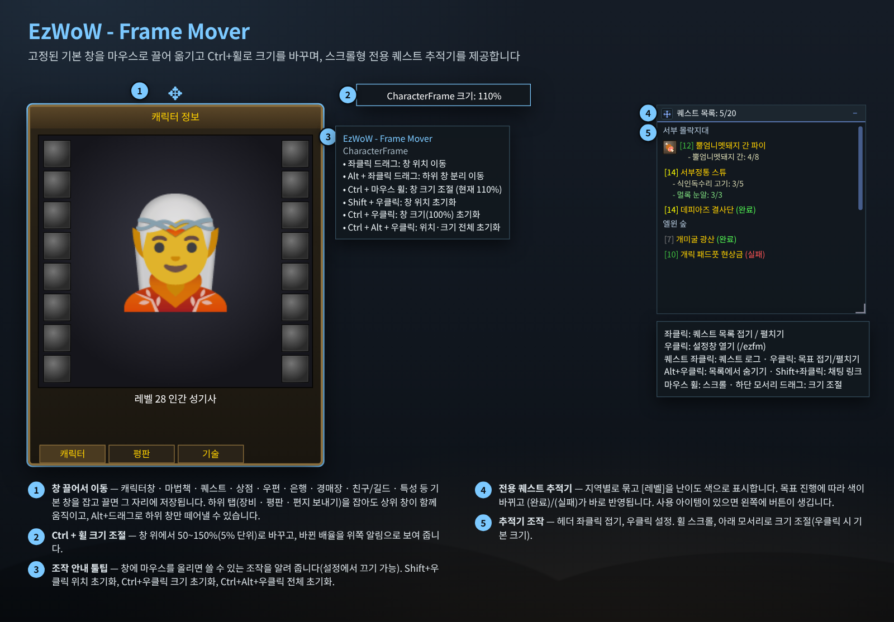
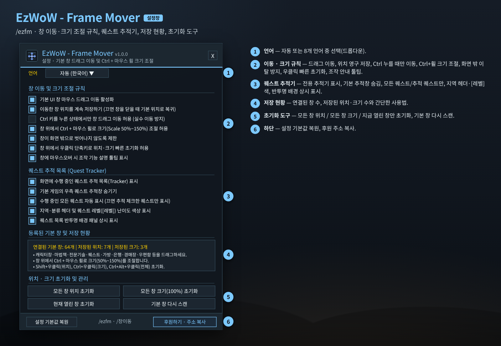
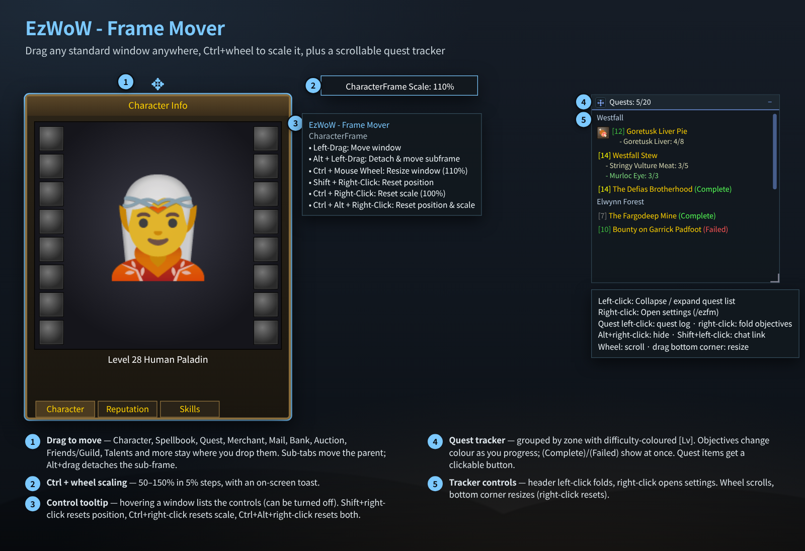
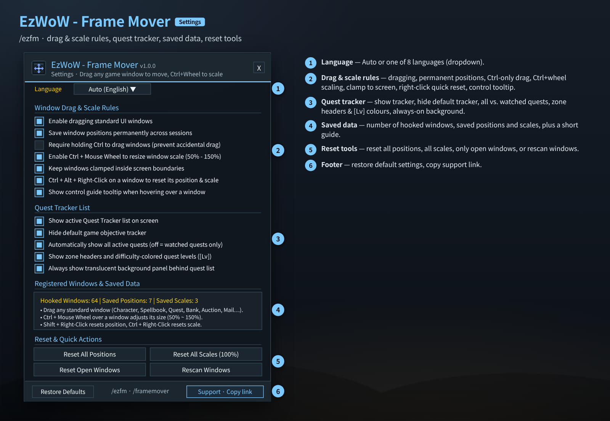

# EzWoW - Frame Mover (`EzWoW-FrameMover`)

## CurseForge

- **Project ID / 프로젝트 ID:** `1755569`
- **Project page / 프로젝트 페이지:** [EzWoW-FrameMover](https://www.curseforge.com/wow/addons/ezwow-frame-mover)

**[한국어](#한국어) · [English](#english)**

WoW Forever (`Interface: 16001`) · `/ezfm`

---

## 한국어

### 개요

움직일 수 없던 **블리자드 기본 창을 마우스로 끌어 옮기고**, 그 위치를 저장해 주는 애드온입니다. 창 위에서 **Ctrl + 마우스 휠**로 크기(50~150%)도 바꿀 수 있습니다. 기본 퀘스트 추적창 대신 쓸 수 있는 **스크롤형 전용 퀘스트 추적기**도 들어 있습니다.

### 화면 미리보기

> 이미지는 애드온 코드의 창 크기·좌표·색상·문구로 재현한 **예시 화면**입니다. 캐릭터 창은 기본 게임 창을 단순화해 그린 것입니다.

### 설치

1. `EzWoW-FrameMover` 폴더를 `Interface/AddOns/` 폴더에 넣습니다.
2. 캐릭터 선택 화면의 **애드온** 목록에서 켭니다.
3. 아무 기본 창(캐릭터 창 `C` 등)을 열고 끌어 보세요. 설정은 `/ezfm`.

### 사용법 (위 그림의 번호)

| 번호 | 기능 | 설명 |
|---|---|---|
| ① | 끌어서 이동 | 캐릭터 창, 마법책, 퀘스트 목록·대화창, 상점, 우편함, 은행, 친구/길드 창, 경매장, 특성 창, 전문기술 훈련사, 업적, 달력 등 기본 창과 나중에 로드되는 창을 끌어서 옮깁니다. 위치는 저장되고, 다른 창이 열릴 때 원위치로 돌아가는 현상을 막습니다. 장비·평판 탭, 편지 보내기처럼 **하위 영역을 잡아도 상위 창이 같이 움직이고**, **Alt + 좌클릭 드래그**로 하위 창만 떼어 낼 수 있습니다. |
| ② | Ctrl + 휠 크기 조절 | 창 위에서 Ctrl을 누른 채 휠을 굴리면 50~150%(5% 단위)로 바뀌고, 화면 위쪽에 `CharacterFrame 크기: 110%` 같은 알림이 잠깐 나옵니다. |
| ③ | 조작 안내 툴팁 | 창에 마우스를 올리면 쓸 수 있는 조작을 알려 줍니다(설정에서 끌 수 있음). |
| ④ | 전용 퀘스트 추적기 | 수행 중인 퀘스트를 **지역별로 묶고 `[레벨]`을 난이도 색**으로 보여 줍니다. 목표 진행에 따라 색이 바뀌고 `(완료)`·`(실패)`가 바로 반영됩니다. 사용 아이템이 필요한 퀘스트는 왼쪽에 **아이템 버튼**이 생겨 바로 클릭해 쓸 수 있습니다. |
| ⑤ | 추적기 조작 | 아래 표 참고 |

#### 창 위 단축 조작

| 조작 | 결과 |
|---|---|
| 좌클릭 드래그 | 창 이동 (설정에서 “Ctrl 누를 때만”으로 바꿀 수 있음) |
| Alt + 좌클릭 드래그 | 하위 창 분리 이동 |
| Ctrl + 마우스 휠 | 창 크기 50~150% |
| Shift + 우클릭 | 그 창 위치 초기화 |
| Ctrl + 우클릭 | 그 창 크기 100%로 초기화 |
| Alt + 우클릭 | 분리한 하위 창을 다시 붙이기 |
| Ctrl + Alt + 우클릭 | 위치·크기 모두 초기화 |

#### 퀘스트 추적기 조작

| 조작 | 결과 |
|---|---|
| 헤더 좌클릭 / 우클릭 | 목록 접기·펼치기 / 설정창 열기 |
| 퀘스트 좌클릭 | 그 퀘스트의 퀘스트 로그 열기 |
| 퀘스트 우클릭 | 목표 접기·펼치기 |
| Alt + 우클릭 | 목록에서 숨기기 |
| Shift + 좌클릭 | 채팅창에 퀘스트 링크 / 추적 해제 |
| 마우스 휠 | 긴 목록 스크롤 |
| 아래 모서리 드래그 | 가로·세로 크기 조절 (우클릭: 기본 크기 270×360) |

- 전문기술 창(`TradeSkillFrame`, `CraftFrame`)은 오류를 막기 위해 일부러 건드리지 않습니다.
- 전투 중에는 보호된 창 속성을 바꾸지 않습니다. 전투가 끝난 뒤 다시 시도하세요.

### 설정창 (`/ezfm`)

| 번호 | 항목 | 기본값 |
|---|---|---|
| ① | 언어 (자동 + 8개 언어) | 자동 |
| ② | 기본 UI 창 마우스 드래그 이동 활성화 | 켬 |
| ② | 이동한 창 위치를 계속 저장하기 (끄면 창을 닫을 때 기본 위치로 복귀) | 켬 |
| ② | Ctrl 키를 누른 상태에서만 창 드래그 이동 허용 (실수 이동 방지) | 끔 |
| ② | 창 위에서 Ctrl + 마우스 휠로 크기(50%~150%) 조절 허용 | 켬 |
| ② | 창이 화면 밖으로 벗어나지 않도록 제한 | 켬 |
| ② | 창 위에서 우클릭 단축키로 위치·크기 빠른 초기화 허용 | 켬 |
| ② | 창에 마우스오버 시 조작 기능 설명 툴팁 표시 | 켬 |
| ③ | 화면에 수행 중인 퀘스트 추적 목록(Tracker) 표시 | 켬 |
| ③ | 기본 게임의 우측 퀘스트 추적창 숨기기 | 켬 |
| ③ | 수행 중인 모든 퀘스트 자동 표시 (끄면 추적 체크한 퀘스트만) | 켬 |
| ③ | 지역·분류 헤더 및 퀘스트 레벨 난이도 색상 표시 | 켬 |
| ③ | 퀘스트 목록 반투명 배경 패널 상시 표시 | 켬 |
| ④ | 저장 현황: 연결된 기본 창 수 · 저장된 위치 수 · 저장된 크기 수와 간단한 사용법 | - |
| ⑤ | 모든 창 위치 초기화 · 모든 창 크기(100%) 초기화 · 현재 열린 창 초기화 · 기본 창 다시 스캔 | - |
| ⑥ | 설정 기본값 복원 · 후원하기 | - |

### 명령어 (`/ezfm`, `/framemover`, `/창이동`)

| 명령어 | 설명 |
|---|---|
| `/ezfm` | 설정창 열기/닫기 |
| `/ezfm reset` (`/창이동 초기화`) | 저장된 모든 창 위치와 크기(100%) 초기화 |
| `/ezfm scan` (`/창이동 스캔`) | 열려 있거나 새로 로드된 기본 창 다시 찾기 |

### 저장 데이터

- `EzWoW_FrameMoverDB`: 설정, 창별 위치·크기, 퀘스트 추적기 크기·접힘·숨긴 퀘스트.

---

## English

### Overview

Frame Mover lets you **drag Blizzard's fixed windows anywhere** and remembers where you put them. **Ctrl + mouse wheel** over a window scales it from 50% to 150%. It also includes a **scrollable quest tracker** that can replace the default objective tracker.

### Screenshots

> These are **mock-ups** rebuilt from the window sizes, coordinates, colours and strings in the code. The character window is a simplified drawing of the default game window.

### Installation

1. Copy the `EzWoW-FrameMover` folder into `Interface/AddOns/`.
2. Enable it in the **AddOns** list on the character select screen.
3. Open any default window (e.g. Character, `C`) and drag it. Settings: `/ezfm`.

### How to use (numbers in the picture)

| No. | Feature | Description |
|---|---|---|
| ① | Drag to move | Character, Spellbook, Quest log/dialog, Merchant, Mail, Bank, Friends/Guild, Auction House, Talents, trainers, Achievements, Calendar and load-on-demand windows can be dragged. Positions are saved and windows no longer snap back when another panel opens. Dragging a **sub-area** (equipment, reputation, send mail…) moves the parent; **Alt + left-drag** detaches the sub-frame. |
| ② | Ctrl + wheel scaling | Hold Ctrl and scroll over a window for 50–150% (5% steps). A toast such as `CharacterFrame Scale: 110%` appears briefly. |
| ③ | Control tooltip | Hovering a window lists the available controls (can be turned off). |
| ④ | Quest tracker | Active quests **grouped by zone with difficulty-coloured `[Lv]`**. Objectives change colour as you progress and `(Complete)` / `(Failed)` show at once. Quests with a usable item get an **item button** you can click directly. |
| ⑤ | Tracker controls | See the table below |

#### Window shortcuts

| Action | Result |
|---|---|
| Left-drag | Move the window (can be set to require Ctrl) |
| Alt + left-drag | Detach and move a sub-frame |
| Ctrl + mouse wheel | Scale 50–150% |
| Shift + right-click | Reset that window's position |
| Ctrl + right-click | Reset that window's scale to 100% |
| Alt + right-click | Re-attach a detached sub-frame |
| Ctrl + Alt + right-click | Reset both position and scale |

#### Quest tracker controls

| Action | Result |
|---|---|
| Header left-click / right-click | Collapse/expand the list / open settings |
| Quest left-click | Open that quest in the quest log |
| Quest right-click | Collapse/expand its objectives |
| Alt + right-click | Hide it from the list |
| Shift + left-click | Link in chat / stop tracking |
| Mouse wheel | Scroll long lists |
| Drag the bottom corner | Resize (right-click: default 270×360) |

- Profession windows (`TradeSkillFrame`, `CraftFrame`) are skipped on purpose to avoid UI errors.
- Protected window attributes are never changed in combat; try again after combat.

### Settings window (`/ezfm`)

| No. | Option | Default |
|---|---|---|
| ① | Language (Auto + 8 languages) | Auto |
| ② | Enable dragging standard UI windows | On |
| ② | Save window positions permanently across sessions | On |
| ② | Require holding Ctrl to drag windows (prevent accidental drag) | Off |
| ② | Enable Ctrl + Mouse Wheel to resize window scale (50% - 150%) | On |
| ② | Keep windows clamped inside screen boundaries | On |
| ② | Right-click shortcuts on a window to reset its position & scale | On |
| ② | Show control guide tooltip when hovering over a window | On |
| ③ | Show active Quest Tracker list on screen | On |
| ③ | Hide default game objective tracker | On |
| ③ | Automatically show all active quests (off = watched quests only) | On |
| ③ | Show zone headers and difficulty-colored quest levels ([Lv]) | On |
| ③ | Always show translucent background panel behind quest list | On |
| ④ | Saved data: hooked windows, saved positions and scales, plus a short guide | - |
| ⑤ | Reset All Positions · Reset All Scales (100%) · Reset Open Windows · Rescan Windows | - |
| ⑥ | Restore Defaults · Support | - |

### Slash commands (`/ezfm`, `/framemover`, `/창이동`)

| Command | Description |
|---|---|
| `/ezfm` | Open/close settings |
| `/ezfm reset` | Reset all saved positions and scales (100%) |
| `/ezfm scan` | Find open or newly loaded default windows again |

### Saved data

- `EzWoW_FrameMoverDB`: settings, per-window positions and scales, tracker size, collapsed and hidden quests.

---

## Support / 후원

If you find this addon useful, you can support its development.

애드온이 도움이 되셨다면 개발 후원으로 응원해 주세요.

[Buy Me a Coffee ☕](https://buymeacoffee.com/qqhrqqhr2)

## Automated releases / 자동 릴리즈

GitHub 릴리즈를 게시하면 CurseForge에 자동 업로드합니다. 최초 설정에 Actions Secret `CF_API_TOKEN`이 필요합니다.

Publishing a GitHub release triggers the CurseForge upload workflow. Set the repository Actions secret `CF_API_TOKEN` first.

[Setup and release instructions / 설정 및 배포 방법](docs/RELEASE.md)
