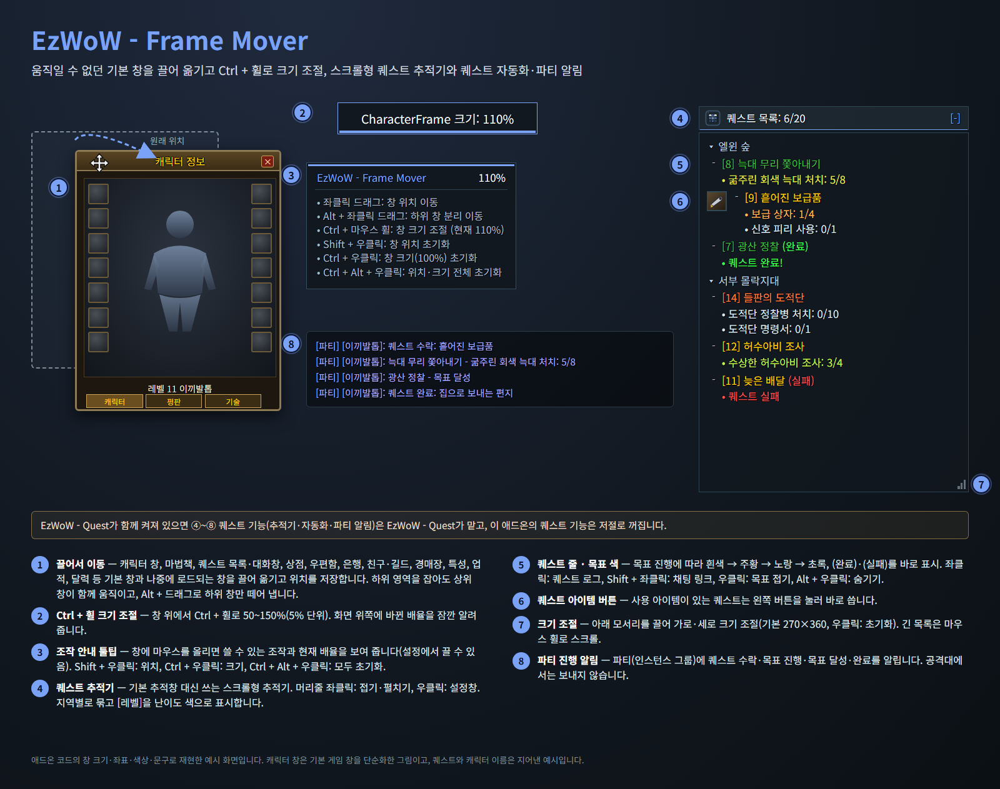
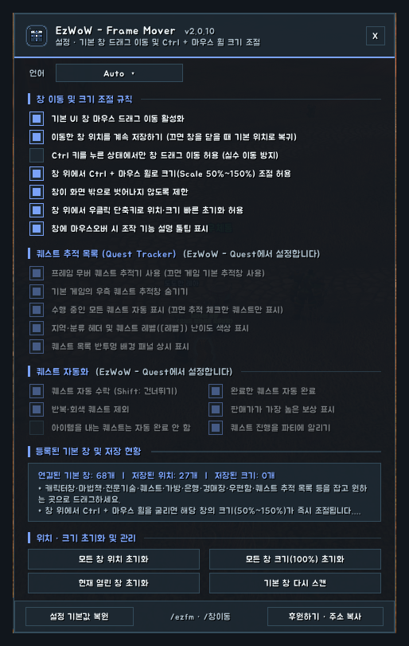

# EzWoW - Frame Mover (`EzWoW-FrameMover`)

## CurseForge

- **Project ID / 프로젝트 ID:** `1755569`
- **Project page / 프로젝트 페이지:** [EzWoW-FrameMover](https://www.curseforge.com/wow/addons/ezwow-frame-mover)

**[한국어](#한국어) · [English](#english)**

WoW Forever (`Interface: 16001`) · `/ezfm`

---

## 한국어

### 개요

움직일 수 없던 **블리자드 기본 창을 마우스로 끌어 옮기고**, 그 위치를 저장해 주는 애드온입니다. 창 위에서 **Ctrl + 마우스 휠**로 크기(50~150%)도 바꿀 수 있습니다. 기본 퀘스트 추적창 대신 쓸 수 있는 **스크롤형 전용 퀘스트 추적기**, **퀘스트 자동화**, **파티 진행 알림**도 들어 있습니다.

> **EzWoW - Quest**가 함께 켜져 있으면 퀘스트 추적기·퀘스트 자동화·파티 진행 알림은 EzWoW - Quest가 맡습니다. 자세한 내용은 [EzWoW - Quest와 함께 쓰기](#ezwow---quest와-함께-쓰기)를 보세요.

### 화면 미리보기

> 실제 게임 화면입니다(WoW Forever, 한국어 클라이언트). 캐릭터 · 다른 플레이어 이름과 채팅 내용은 가렸습니다.

### 설치

1. `EzWoW-FrameMover` 폴더를 `Interface/AddOns/` 폴더에 넣습니다.
2. 캐릭터 선택 화면의 **애드온** 목록에서 켭니다.
3. 아무 기본 창(캐릭터 창 `C` 등)을 열고 끌어 보세요. 설정은 `/ezfm`.

### 사용법

| 번호 | 기능 | 설명 |
|---|---|---|
| ① | 끌어서 이동 | 캐릭터 창, 마법책, 퀘스트 목록·대화창, 상점, 우편함, 은행, 친구/길드 창, 경매장, 특성 창, 전문기술 훈련사, 업적, 달력 등 기본 창과 나중에 로드되는 창을 끌어서 옮깁니다. 위치는 저장되고, 다른 창이 열릴 때 원위치로 돌아가는 현상을 막습니다. 장비·평판 탭, 편지 보내기처럼 **하위 영역을 잡아도 상위 창이 같이 움직이고**, **Alt + 좌클릭 드래그**로 하위 창만 떼어 낼 수 있습니다. |
| ② | Ctrl + 휠 크기 조절 | 창 위에서 Ctrl을 누른 채 휠을 굴리면 50~150%(5% 단위)로 바뀌고, 화면 위쪽에 `CharacterFrame 크기: 110%` 같은 알림이 잠깐 나옵니다. |
| ③ | 조작 안내 툴팁 | 창에 마우스를 올리면 쓸 수 있는 조작과 현재 배율을 알려 줍니다(설정에서 끌 수 있음). |
| ④ | 전용 퀘스트 추적기 | 수행 중인 퀘스트를 **지역별로 묶고 `[레벨]`을 난이도 색**으로 보여 줍니다. 머리줄 좌클릭: 접기·펼치기, 우클릭: 설정창. |
| ⑤ | 퀘스트 줄 · 목표 색 | 목표 진행에 따라 흰색 → 주황 → 노랑 → 초록으로 바뀌고 `(완료)`·`(실패)`가 바로 반영됩니다. 조작은 아래 표 참고. |
| ⑥ | 퀘스트 아이템 버튼 | 사용 아이템이 필요한 퀘스트는 왼쪽에 버튼이 생겨 바로 클릭해 씁니다. |
| ⑦ | 크기 조절 | 아래 모서리를 끌어 가로·세로 크기 조절(기본 270×360, 우클릭: 초기화). 긴 목록은 마우스 휠로 스크롤. |
| ⑧ | 파티 진행 알림 | 파티(인스턴스 그룹)에 퀘스트 수락·목표 진행·목표 달성·완료를 알립니다. 공격대에서는 보내지 않습니다. |

#### 창 위 단축 조작

| 조작 | 결과 |
|---|---|
| 좌클릭 드래그 | 창 이동 (설정에서 “Ctrl 누를 때만”으로 바꿀 수 있음) |
| Alt + 좌클릭 드래그 | 하위 창 분리 이동 |
| Ctrl + 마우스 휠 | 창 크기 50~150% |
| Shift + 우클릭 | 그 창 위치 초기화 |
| Ctrl + 우클릭 | 그 창 크기 100%로 초기화 |
| Alt + 우클릭 | 분리한 하위 창을 다시 붙이기 |
| Ctrl + Alt + 우클릭 | 위치·크기 모두 초기화 |

#### 퀘스트 추적기 조작

| 조작 | 결과 |
|---|---|
| 헤더 좌클릭 / 우클릭 | 목록 접기·펼치기 / 설정창 열기 |
| 퀘스트 좌클릭 | 그 퀘스트의 퀘스트 로그 열기 |
| 퀘스트 우클릭 | 목표 접기·펼치기 |
| Alt + 우클릭 | 목록에서 숨기기 |
| Shift + 좌클릭 | 채팅창에 퀘스트 링크 / 추적 해제 |
| 마우스 휠 | 긴 목록 스크롤 |
| 아래 모서리 드래그 | 가로·세로 크기 조절 (우클릭: 기본 크기 270×360) |

- 전문기술 창(`TradeSkillFrame`, `CraftFrame`)은 오류를 막기 위해 일부러 건드리지 않습니다.
- 전투 중에는 보호된 창 속성을 바꾸지 않습니다. 전투가 끝난 뒤 다시 시도하세요.

### 퀘스트 자동화

설정창의 **퀘스트 자동화** 항목에서 켭니다(처음에는 꺼져 있음). NPC와 대화할 때 **Shift**를 누르고 있으면 그 대화에서는 자동화가 동작하지 않습니다.

| 항목 | 설명 | 기본값 |
|---|---|---|
| 퀘스트 자동 수락 | 퀘스트를 바로 수락합니다. 퀘스트가 없고 대화 선택지가 하나뿐인 NPC는 그 선택지를 자동으로 고릅니다(초기화 같은 선택지는 제외). 일행이 공유한 퀘스트·호위 퀘스트 확인 창도 자동으로 수락합니다. | 끔 |
| 완료한 퀘스트 자동 완료 | 목표를 다 채운 퀘스트를 바로 완료합니다. 보상을 골라야 하면 직접 고릅니다. 골드를 내는 퀘스트는 완료하지 않습니다. | 끔 |
| 반복·회색 퀘스트 제외 | 반복·일일 퀘스트와 레벨이 낮은 회색 퀘스트는 자동 수락하지 않습니다. | 켬 |
| 아이템을 내는 퀘스트는 자동 완료 안 함 | 아이템을 건네야 하는 퀘스트는 직접 완료합니다. | 끔 |
| 판매가가 가장 높은 보상 표시 | 보상을 고를 때 상점 판매가가 가장 높은 아이템에 금화 표시를 붙입니다. | 켬 |
| 퀘스트 진행을 파티에 알리기 | 파티(인스턴스 그룹)에 수락·목표 진행·목표 달성·완료를 알립니다. 공격대에서는 보내지 않습니다. | 켬 |

### 설정창 (`/ezfm`)

| 번호 | 항목 | 기본값 |
|---|---|---|
| ① | 언어 (자동 + 8개 언어) | 자동 |
| ② | 기본 UI 창 마우스 드래그 이동 활성화 | 켬 |
| ② | 이동한 창 위치를 계속 저장하기 (끄면 창을 닫을 때 기본 위치로 복귀) | 켬 |
| ② | Ctrl 키를 누른 상태에서만 창 드래그 이동 허용 (실수 이동 방지) | 끔 |
| ② | 창 위에서 Ctrl + 마우스 휠로 크기(50%~150%) 조절 허용 | 켬 |
| ② | 창이 화면 밖으로 벗어나지 않도록 제한 | 켬 |
| ② | 창 위에서 우클릭 단축키로 위치·크기 빠른 초기화 허용 | 켬 |
| ② | 창에 마우스오버 시 조작 기능 설명 툴팁 표시 | 켬 |
| ③ | 프레임 무버 퀘스트 추적기 사용 (끄면 게임 기본 추적창 사용) · 끄면 아래 추적기 옵션은 비활성화 | 켬 |
| ③ | 기본 게임의 우측 퀘스트 추적창 숨기기 | 켬 |
| ③ | 수행 중인 모든 퀘스트 자동 표시 (끄면 추적 체크한 퀘스트만) | 켬 |
| ③ | 지역·분류 헤더 및 퀘스트 레벨 난이도 색상 표시 | 켬 |
| ③ | 퀘스트 목록 반투명 배경 패널 상시 표시 | 켬 |
| ④ | 퀘스트 자동화 (위 표 참고) | - |
| ⑤ | 저장 현황: 연결된 기본 창 수 · 저장된 위치 수 · 저장된 크기 수와 간단한 사용법 | - |
| ⑥ | 모든 창 위치 초기화 · 모든 창 크기(100%) 초기화 · 현재 열린 창 초기화 · 기본 창 다시 스캔 | - |
| ⑦ | 설정 기본값 복원 · 후원하기 | - |

- **EzWoW - Quest**가 켜져 있으면 ③·④ 항목은 흐려지고 제목 옆에 “(EzWoW - Quest에서 설정합니다)”가 붙습니다.

### 명령어 (`/ezfm`, `/framemover`, `/창이동`)

| 명령어 | 설명 |
|---|---|
| `/ezfm` | 설정창 열기/닫기 |
| `/ezfm reset` (`/창이동 초기화`) | 저장된 모든 창 위치와 크기(100%) 초기화 |
| `/ezfm scan` (`/창이동 스캔`) | 열려 있거나 새로 로드된 기본 창 다시 찾기 |

### EzWoW - Quest와 함께 쓰기

- 퀘스트 추적기·퀘스트 자동화·파티 진행 알림은 퀘스트 전용 애드온 **EzWoW - Quest**에도 들어 있습니다. EzWoW - Quest가 켜져 있으면 이 애드온의 퀘스트 기능은 저절로 꺼지고 EzWoW - Quest가 맡으므로, 두 번 동작하지 않습니다.
- EzWoW - Quest는 처음 실행할 때 이 애드온의 퀘스트 설정(추적기 크기·위치·접힘·숨긴 퀘스트, 자동화 옵션)을 **한 번** 가져갑니다.
- EzWoW - Quest를 끄면 예전처럼 이 애드온이 퀘스트 기능을 맡습니다. 창 이동·크기 조절은 언제나 이 애드온이 맡습니다.

### 저장 데이터

- `EzWoW_FrameMoverDB`: 설정, 창별 위치·크기, 퀘스트 추적기 크기·접힘·숨긴 퀘스트.

<!-- ezwow-pad-share -->
### 게임패드
- 게임패드 UI를 켜면 EzWoW 창을 패드로 다룰 수 있습니다. 방향키로 이동, A(✕)로 누르기, X(□)로 오른쪽 클릭, LB/RB로 스크롤, B(○)로 닫기입니다. 창 아래에 연결된 패드 모양으로 키 안내가 나옵니다.
- 블리자드 창이 열려 있지 않을 때 **보기(Back) / Create 버튼**을 누르면 화면의 EzWoW 프레임(유틸리티 바, 퀘스트 목록 등)으로 이동합니다. 다시 누르거나 B를 누르면 돌아갑니다.
- 다른 버튼을 쓰려면 설정 > 단축키 > 애드온 > EzWoW > "게임패드: EzWoW 창으로 이동/돌아가기"에 지정합니다(EzWoW-MapFinder가 설치돼 있을 때).

### 기록 공유
- 모든 EzWoW 애드온이 함께 쓰는 기록 공유가 **기본으로 켜져 있습니다**. 직접 확인한 퀘스트 NPC, 희귀 몬스터 목격, 아이템 드롭, 채집 위치를 다른 EzWoW 사용자와 나눕니다.
- `/ezshare` 또는 `/공유`: `on` / `off` 켜기·끄기, `channel on` / `channel off` 서버 채널 사용, `status` 현재 상태와 기록 수.

---

## English

### Overview

Frame Mover lets you **drag Blizzard's fixed windows anywhere** and remembers where you put them. **Ctrl + mouse wheel** over a window scales it from 50% to 150%. It also includes a **scrollable quest tracker** that can replace the default objective tracker, **quest automation** and **party progress messages**.

> When **EzWoW - Quest** is enabled, the quest tracker, quest automation and party messages are handled by EzWoW - Quest. See [Working with EzWoW - Quest](#working-with-ezwow---quest).

### Screenshots

> In-game screenshots with the addon set to English. The game client is Korean, so game text such as zone, item and spell names stays Korean. Character and player names and chat text are blurred.

### Installation

1. Copy the `EzWoW-FrameMover` folder into `Interface/AddOns/`.
2. Enable it in the **AddOns** list on the character select screen.
3. Open any default window (e.g. Character, `C`) and drag it. Settings: `/ezfm`.

### How to use

| No. | Feature | Description |
|---|---|---|
| ① | Drag to move | Character, Spellbook, Quest log/dialog, Merchant, Mail, Bank, Friends/Guild, Auction House, Talents, trainers, Achievements, Calendar and load-on-demand windows can be dragged. Positions are saved and windows no longer snap back when another panel opens. Dragging a **sub-area** (equipment, reputation, send mail…) moves the parent; **Alt + left-drag** detaches the sub-frame. |
| ② | Ctrl + wheel scaling | Hold Ctrl and scroll over a window for 50–150% (5% steps). A toast such as `CharacterFrame Scale: 110%` appears briefly. |
| ③ | Control tooltip | Hovering a window lists the available controls and its current scale (can be turned off). |
| ④ | Quest tracker | Active quests **grouped by zone with difficulty-coloured `[Lv]`**. Header left-click: collapse or expand, right-click: settings. |
| ⑤ | Quest line · objective colours | Objectives go white → orange → yellow → green as you progress; `(Complete)` / `(Failed)` show at once. Controls: see the table below. |
| ⑥ | Quest item button | Quests with a usable item get a button on the left; click it to use the item. |
| ⑦ | Resize | Drag the bottom corner to resize (default 270×360, right-click: reset). Long lists scroll with the mouse wheel. |
| ⑧ | Party progress messages | Tells your party (or instance group) when you accept a quest, make progress, finish the objectives and turn it in. Never sent in a raid. |

#### Window shortcuts

| Action | Result |
|---|---|
| Left-drag | Move the window (can be set to require Ctrl) |
| Alt + left-drag | Detach and move a sub-frame |
| Ctrl + mouse wheel | Scale 50–150% |
| Shift + right-click | Reset that window's position |
| Ctrl + right-click | Reset that window's scale to 100% |
| Alt + right-click | Re-attach a detached sub-frame |
| Ctrl + Alt + right-click | Reset both position and scale |

#### Quest tracker controls

| Action | Result |
|---|---|
| Header left-click / right-click | Collapse/expand the list / open settings |
| Quest left-click | Open that quest in the quest log |
| Quest right-click | Collapse/expand its objectives |
| Alt + right-click | Hide it from the list |
| Shift + left-click | Link in chat / stop tracking |
| Mouse wheel | Scroll long lists |
| Drag the bottom corner | Resize (right-click: default 270×360) |

- Profession windows (`TradeSkillFrame`, `CraftFrame`) are skipped on purpose to avoid UI errors.
- Protected window attributes are never changed in combat; try again after combat.

### Quest automation

Turn it on in the **Quest automation** section of the settings (off by default). Hold **Shift** while talking to an NPC to skip automation for that conversation.

| Option | Description | Default |
|---|---|---|
| Auto accept quests | Accepts quests right away. An NPC with no quests and only one dialogue option gets that option picked (reset-type options are skipped). Shared and escort quest confirmations are accepted too. | Off |
| Auto turn in finished quests | Turns in completed quests. If you must choose a reward you pick it yourself. Quests that cost gold are never turned in. | Off |
| Skip repeatable and grey quests | Repeatable/daily and low-level grey quests are not auto accepted. | On |
| Do not auto turn in quests that take items | Quests that take items from you are left for you to turn in. | Off |
| Mark the reward that sells for most | Puts a gold mark on the reward choice with the highest vendor price. | On |
| Announce quest progress to party | Tells your party (or instance group) about accepted quests, progress, finished objectives and turn-ins. Never sent in a raid. | On |

### Settings window (`/ezfm`)

| No. | Option | Default |
|---|---|---|
| ① | Language (Auto + 8 languages) | Auto |
| ② | Enable dragging standard UI windows | On |
| ② | Save window positions permanently across sessions | On |
| ② | Require holding Ctrl to drag windows (prevent accidental drag) | Off |
| ② | Enable Ctrl + Mouse Wheel to resize window scale (50% - 150%) | On |
| ② | Keep windows clamped inside screen boundaries | On |
| ② | Ctrl + Alt + Right-Click on a window to reset its position & scale | On |
| ② | Show control guide tooltip when hovering over a window | On |
| ③ | Use Frame Mover quest tracker (off = game default tracker) · tracker options below are disabled while off | On |
| ③ | Hide default game objective tracker | On |
| ③ | Automatically show all active quests (off = watched quests only) | On |
| ③ | Show zone headers and difficulty-colored quest levels ([Lv]) | On |
| ③ | Always show translucent background panel behind quest list | On |
| ④ | Quest automation (see the table above) | - |
| ⑤ | Saved data: hooked windows, saved positions and scales, plus a short guide | - |
| ⑥ | Reset All Positions · Reset All Scales (100%) · Reset Open Windows · Rescan Windows | - |
| ⑦ | Restore Defaults · Support | - |

- While **EzWoW - Quest** is enabled, sections ③ and ④ are dimmed and their titles read “(set in EzWoW - Quest)”.

### Slash commands (`/ezfm`, `/framemover`, `/창이동`)

| Command | Description |
|---|---|
| `/ezfm` | Open/close settings |
| `/ezfm reset` | Reset all saved positions and scales (100%) |
| `/ezfm scan` | Find open or newly loaded default windows again |

### Working with EzWoW - Quest

- The quest tracker, quest automation and party progress messages are also part of the quest addon **EzWoW - Quest**. While EzWoW - Quest is enabled, the quest features of this addon turn themselves off and EzWoW - Quest takes over, so nothing runs twice.
- On its first start, EzWoW - Quest carries over the quest settings of this addon (tracker size, position, folded and hidden quests, automation options) **once**.
- Disable EzWoW - Quest and this addon handles quests as before. Moving and scaling windows always stays in this addon.

### Saved data

- `EzWoW_FrameMoverDB`: settings, per-window positions and scales, tracker size, collapsed and hidden quests.

### Gamepad
- With the gamepad UI on, EzWoW windows work with a gamepad: D-pad to move, A (✕) to press, X (□) for right-click, LB/RB to scroll, B (○) to close. A key guide in your pad's button style shows under the window.
- With no game window open, press **View (Back) / Create** to move to the EzWoW frames on screen (Utility Bar, quest list and more). Press it again or B to go back.
- To use another button, set Key Bindings > AddOns > EzWoW > "Gamepad: move to / leave the EzWoW frames" (with EzWoW-MapFinder installed).

### Record sharing
- Record sharing, used by all EzWoW addons, is **on by default**. Quest NPCs, rare monster sightings, item drops and gathering spots you have seen yourself are shared with other EzWoW users.
- `/ezshare`: `on` / `off` to turn it on or off, `channel on` / `channel off` for the server channel, `status` for the current state and record counts.

---

## Support / 후원

If you find this addon useful, you can support its development.

애드온이 도움이 되셨다면 개발 후원으로 응원해 주세요.

[Buy Me a Coffee ☕](https://buymeacoffee.com/qqhrqqhr2)

