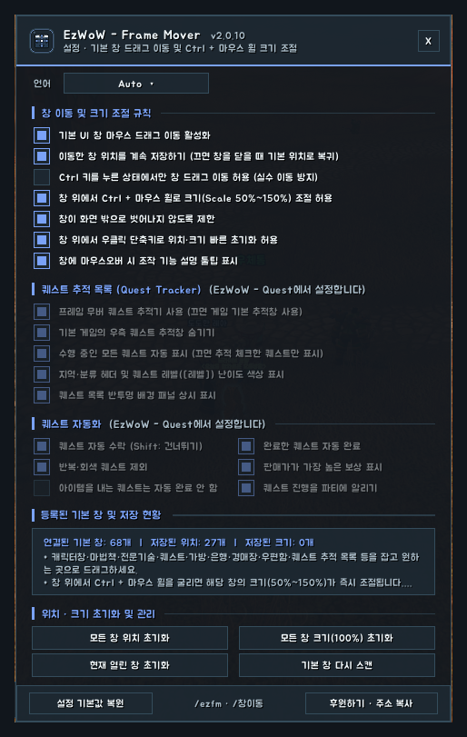
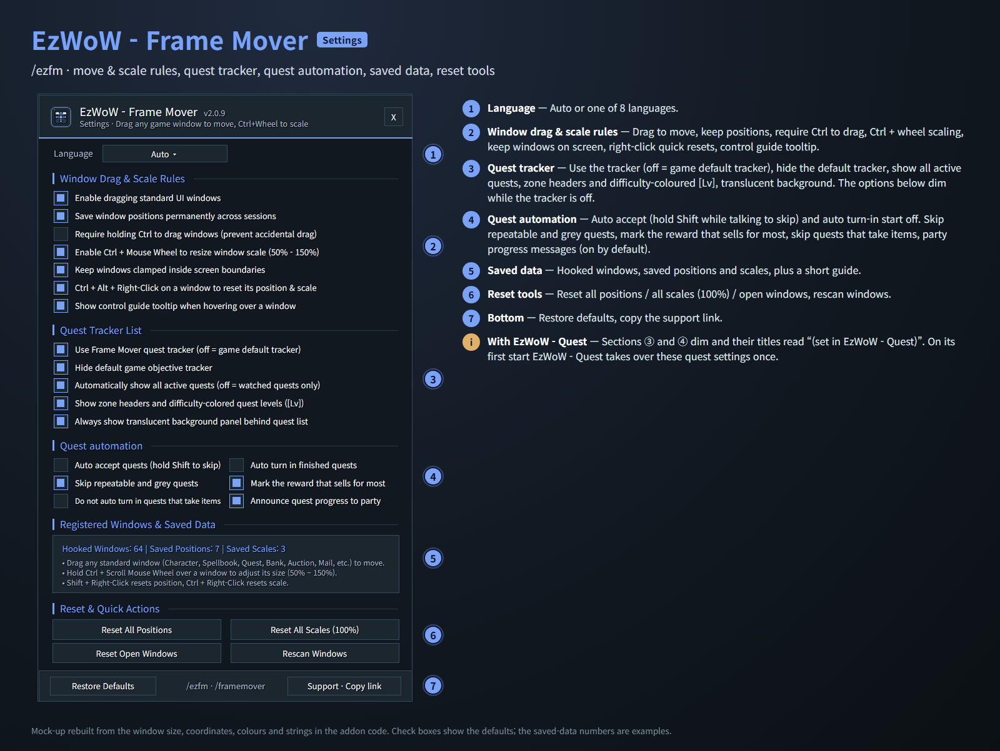
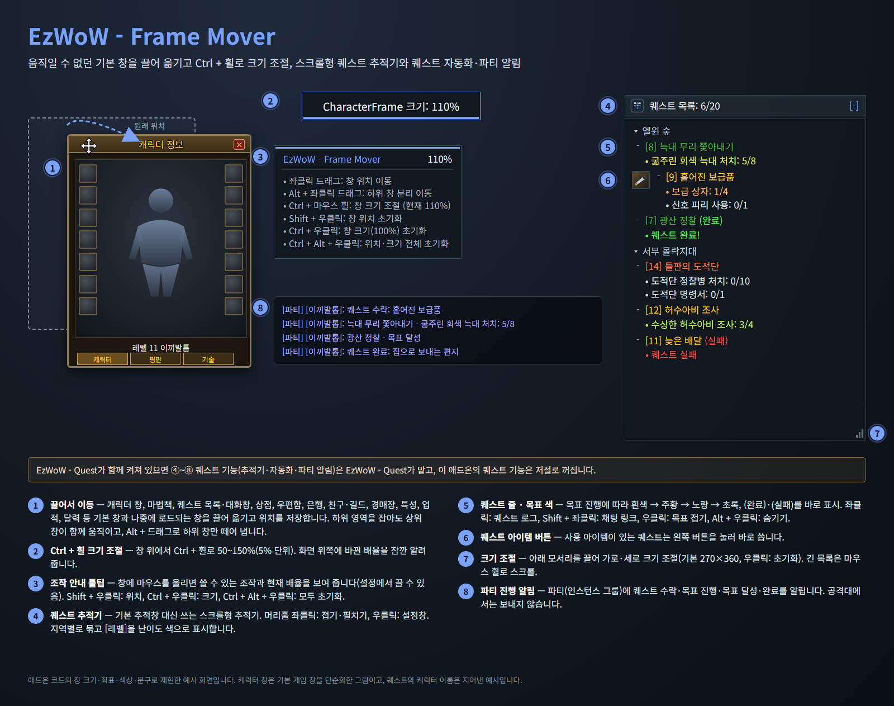
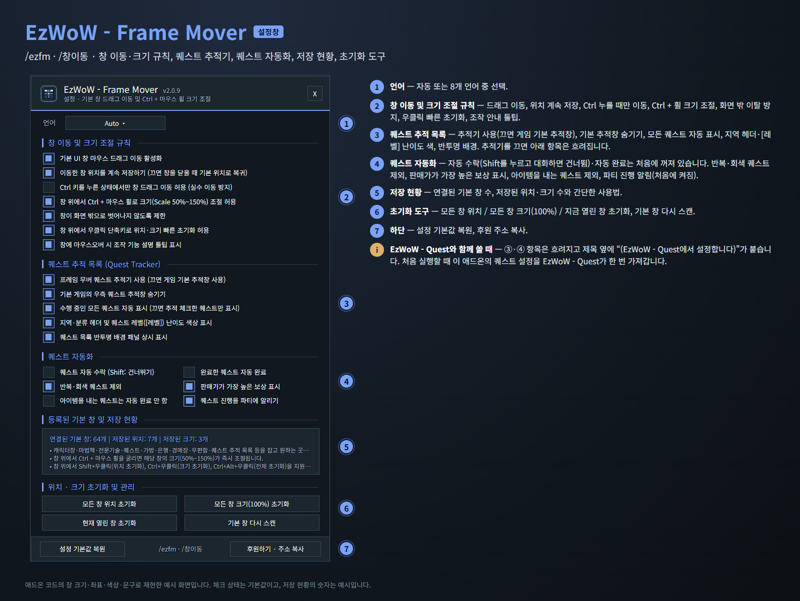

<!--
CurseForge summary (EN): Drag fixed default windows anywhere and scale them with Ctrl + mouse wheel, plus a scrollable quest tracker, quest automation and party progress messages.
CurseForge summary (KO): 움직일 수 없던 기본 창을 끌어 옮기고 Ctrl + 마우스 휠로 크기 조절, 스크롤형 퀘스트 추적기와 퀘스트 자동화·파티 진행 알림.
-->

# EzWoW - Frame Mover

**English** · [한국어](#한국어)

Drag the fixed default windows of WoW Forever anywhere, keep them where you put them, and scale them with Ctrl + mouse wheel. It also includes a scrollable quest tracker, quest automation and party progress messages.

*Mock-ups rebuilt from the window sizes, coordinates, colours and strings in the addon code. Quests and names are made up.*

## Features

### Move and scale windows
- Character, Spellbook, Quest log and dialog, Merchant, Mail, Bank, Friends and Guild, Auction House, Talents, Achievements, Calendar and load-on-demand windows can be dragged. Positions are saved and windows no longer snap back when another panel opens.
- Dragging a sub-area (equipment, reputation, send mail…) moves the parent window; **Alt + drag** detaches the sub-frame.
- **Ctrl + mouse wheel** over a window scales it from 50% to 150% (5% steps), with a short notice at the top of the screen.
- Hover a window for a guide tooltip with the available controls and its current scale.
- Shift + right-click: reset position · Ctrl + right-click: reset scale · Ctrl + Alt + right-click: reset both.
- Options to require Ctrl for dragging, keep windows on screen and turn positions saving off.

### Quest tracker
- Replaces the default objective tracker (can be switched back in the settings).
- Quests grouped by zone, with difficulty-coloured `[Lv]` and `(Complete)` / `(Failed)` at once.
- Objectives change colour as you progress: white → orange → yellow → green.
- Quests with a usable item get an item button you can click directly.
- Drag the bottom corner to resize, mouse wheel to scroll.

### Quest automation (off by default)
- Auto accept quests, including shared and escort quest confirmations. Hold **Shift** while talking to skip.
- Auto turn in finished quests. You still choose rewards yourself; quests that cost gold are never turned in.
- Options to skip repeatable and grey quests, and quests that take items.
- A gold mark on the reward that sells for most.

### Party progress messages (on by default)
- Tells your party (or instance group) when you accept a quest, make progress, finish the objectives and turn it in. Never sent in a raid.

## Working with EzWoW - Quest
- The quest tracker, quest automation and party messages are also part of **EzWoW - Quest**. While it is enabled, the quest features here turn themselves off and EzWoW - Quest takes over; the options are shown dimmed with a note.
- EzWoW - Quest carries over these quest settings once, on its first start.
- Moving and scaling windows always stays in this addon.

## Gamepad
- With the gamepad UI on, EzWoW windows work with a gamepad: D-pad to move, A (✕) to press, X (□) for right-click, LB/RB to scroll, B (○) to close. A key guide in your pad's button style shows under the window.
- With no game window open, press **View (Back) / Create** to move to the EzWoW frames on screen. Press it again or B to go back.
- To use another button: Key Bindings > AddOns > EzWoW > "Gamepad: move to / leave the EzWoW frames" (with EzWoW-MapFinder installed).

## Record sharing
- Shared by all EzWoW addons and **on by default**: quest NPCs, rare monster sightings, item drops and gathering spots you have seen yourself are shared with other EzWoW users.
- `/ezshare on` / `off`, `/ezshare channel on` / `off`, `/ezshare status`

## Commands
- `/ezfm`, `/framemover` or `/창이동` — open the settings
- `/ezfm reset` — reset all saved positions and scales
- `/ezfm scan` — find open or newly loaded default windows again

Languages: English, 한국어, Deutsch, Français, Español, Русский, 简体中文, 繁體中文.

---

## 한국어

WoW Forever의 움직일 수 없던 기본 창을 마우스로 끌어 옮기고, 그 위치를 저장하며, Ctrl + 마우스 휠로 크기를 바꾸는 애드온입니다. 스크롤형 퀘스트 추적기, 퀘스트 자동화, 파티 진행 알림도 들어 있습니다.

*애드온 코드의 창 크기·좌표·색상·문구로 재현한 예시 화면입니다. 퀘스트와 이름은 지어낸 예시입니다.*

## 기능

### 창 이동과 크기 조절
- 캐릭터 창, 마법책, 퀘스트 목록·대화창, 상점, 우편함, 은행, 친구·길드, 경매장, 특성, 업적, 달력 등 기본 창과 나중에 로드되는 창을 끌어 옮깁니다. 위치는 저장되고, 다른 창이 열릴 때 원위치로 돌아가는 현상을 막습니다.
- 장비·평판 탭, 편지 보내기처럼 하위 영역을 잡아도 상위 창이 함께 움직이고, **Alt + 드래그**로 하위 창만 떼어 냅니다.
- 창 위에서 **Ctrl + 마우스 휠**로 50~150%(5% 단위) 크기 조절. 화면 위쪽에 바뀐 배율을 잠깐 알려 줍니다.
- 창에 마우스를 올리면 쓸 수 있는 조작과 현재 배율을 툴팁으로 보여 줍니다.
- Shift + 우클릭: 위치 초기화 · Ctrl + 우클릭: 크기 초기화 · Ctrl + Alt + 우클릭: 모두 초기화.
- Ctrl을 누를 때만 이동, 화면 밖 이탈 방지, 위치 저장 끄기 옵션.

### 퀘스트 추적기
- 기본 퀘스트 추적창 대신 사용합니다(설정에서 기본 추적창으로 되돌릴 수 있음).
- 퀘스트를 지역별로 묶고 `[레벨]`을 난이도 색으로, `(완료)`·`(실패)`를 바로 표시합니다.
- 목표 진행에 따라 색이 바뀝니다: 흰색 → 주황 → 노랑 → 초록.
- 사용 아이템이 있는 퀘스트는 아이템 버튼을 눌러 바로 씁니다.
- 아래 모서리를 끌어 크기 조절, 마우스 휠로 스크롤.

### 퀘스트 자동화 (처음에는 꺼짐)
- 퀘스트 자동 수락(공유·호위 퀘스트 확인 포함). 대화할 때 **Shift**를 누르고 있으면 건너뜁니다.
- 완료한 퀘스트 자동 완료. 보상은 직접 고르고, 골드를 내는 퀘스트는 완료하지 않습니다.
- 반복·회색 퀘스트, 아이템을 내는 퀘스트를 제외하는 옵션.
- 판매가가 가장 높은 보상에 금화 표시.

### 파티 진행 알림 (처음부터 켜짐)
- 파티(인스턴스 그룹)에 퀘스트 수락·목표 진행·목표 달성·완료를 알립니다. 공격대에서는 보내지 않습니다.

## EzWoW - Quest와 함께 쓰기
- 퀘스트 추적기·퀘스트 자동화·파티 알림은 **EzWoW - Quest**에도 들어 있습니다. EzWoW - Quest가 켜져 있으면 이 애드온의 퀘스트 기능은 저절로 꺼지고 EzWoW - Quest가 맡습니다. 설정창의 해당 항목은 흐려지고 안내 문구가 붙습니다.
- EzWoW - Quest는 처음 실행할 때 이 퀘스트 설정을 한 번 가져갑니다.
- 창 이동·크기 조절은 언제나 이 애드온이 맡습니다.

## 게임패드
- 게임패드 UI를 켜면 EzWoW 창을 패드로 다룰 수 있습니다. 방향키로 이동, A(✕)로 누르기, X(□)로 오른쪽 클릭, LB/RB로 스크롤, B(○)로 닫기입니다. 창 아래에 연결된 패드 모양으로 키 안내가 나옵니다.
- 블리자드 창이 열려 있지 않을 때 **보기(Back) / Create 버튼**을 누르면 화면의 EzWoW 프레임으로 이동합니다. 다시 누르거나 B를 누르면 돌아갑니다.
- 다른 버튼을 쓰려면: 설정 > 단축키 > 애드온 > EzWoW > "게임패드: EzWoW 창으로 이동/돌아가기" (EzWoW-MapFinder 설치 시)

## 기록 공유
- 모든 EzWoW 애드온이 함께 쓰며 **기본으로 켜져 있습니다**. 직접 확인한 퀘스트 NPC, 희귀 몬스터 목격, 아이템 드롭, 채집 위치를 다른 EzWoW 사용자와 나눕니다.
- `/ezshare on` / `off` (또는 `/공유`), `/ezshare channel on` / `off`, `/ezshare status`

## 명령어
- `/ezfm`, `/framemover` 또는 `/창이동` — 설정창 열기
- `/ezfm reset` (`/창이동 초기화`) — 저장된 모든 창 위치와 크기 초기화
- `/ezfm scan` (`/창이동 스캔`) — 열려 있거나 새로 로드된 기본 창 다시 찾기

지원 언어: English, 한국어, Deutsch, Français, Español, Русский, 简体中文, 繁體中文.

---

**Support:** If you find this addon useful, you can support its development. [Buy Me a Coffee ☕](https://buymeacoffee.com/qqhrqqhr2)

**후원:** 애드온이 도움이 되셨다면 개발 후원으로 응원해 주세요. [Buy Me a Coffee ☕](https://buymeacoffee.com/qqhrqqhr2)
